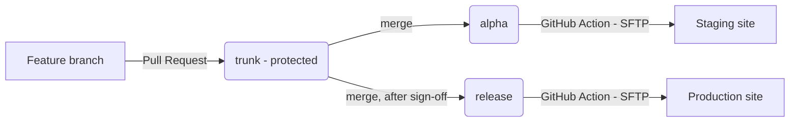

# Colorado Sun — Newspack Custom Plugin Roadmap

A step-by-step plan to stand up a Newspack-compliant WordPress plugin repo and a
two-person GitHub + deployment workflow.

## Ground rules & decisions

- **First WordPress plugin**, built for a Newspack-hosted news site (Colorado Sun).
  Must follow the [Newspack Custom Development Guidelines](https://help.newspack.com/newspack-developer-hub/custom-development-guidelines/)
  and the [Newspack Starter Template](https://help.newspack.com/newspack-developer-hub/how-to-set-up-the-newspack-starter-template-for-custom-plugins/).
- **Repo not created yet.** We create it from the starter template and configure
  secrets/variables **by hand** (we already have SFTP credentials for staging + live).
- **Testing is staging-only — no local WordPress.** The core dev loop is:
  *edit → push `alpha` → GitHub Action deploys to staging over SFTP → verify on staging.*
- **GitHub:** a shared **Organization**, both developers as members. Both on macOS.
- **Delivery order:** the foundational GitHub + VS Code guide is written **first**;
  the task-by-task how-tos come later.
- **Workspace:** this folder (`colorado-sun-wp/`) is where the repo will be cloned.

## How the Newspack model works

- One repo (from the starter template) holds all custom code, organized as
  **Modules** under `inc/Modules/`. Each module has an auto-loaded `module.php`.
- Three branches drive everything:
  - **`trunk`** — default, protected; all pull requests merge here.
  - **`alpha`** — pushing here **auto-deploys to staging**.
  - **`release`** — pushing here **auto-deploys to production**.
- Deploys are automated GitHub Actions that push files over **SFTP** using
  credentials stored as repo **secrets**. You do not hand-SFTP files.
- Every pull request runs **linting** (WordPress + WP-VIP Coding Standards); the
  checks block merges that do not meet standards.

---

## Phase 1 — Foundational Getting-Started Guide *(first deliverable)*

Write a beginner-friendly guide (both developers, macOS), independent of the repo
existing yet. Deliverable: `docs/GETTING_STARTED.md`.

1. **GitHub fundamentals** — repo, branch, commit, pull request; clone vs. pull vs.
   push; the `trunk → alpha → release` model in plain language.
2. **VS Code environment config** — install git, Node (matching the template's
   `.nvmrc`), Composer, and VS Code; recommended extensions; using the Source
   Control panel and the integrated terminal.
3. A one-page mental-model diagram of the full *edit → PR → staging → production* flow.

## Phase 2 — Accounts & toolchain *(can run alongside Phase 1)*

1. Create/choose the **GitHub Organization**; add both developers; agree on roles.
2. Install the macOS toolchain on both machines; verify `git`, `node`, `npm`,
   `composer` versions.

## Phase 3 — Create the repo from the template

1. **Use this template** on `Automattic/newspack-plugin-starter-template` to create
   a new repo in the org.
2. Find/replace `PublisherName` → `ColoradoSun` and `publisher-name` →
   `colorado-sun`; set the plugin header/metadata in `plugin.php`.
3. Keep the sample module in `inc/Modules/` for now (used by the Hello World test),
   then remove it once real modules exist.

## Phase 4 — Configure deployment

1. Add SFTP **secrets** for staging + production:
   - `STAGING_SFTP_USER_<SUFFIX>` / `STAGING_SFTP_PASSWORD_<SUFFIX>`
   - `PROD_SFTP_USER_<SUFFIX>` / `PROD_SFTP_PASSWORD_<SUFFIX>`
   - Suggested `<SUFFIX>`: `COLORADOSUN_COM`.
2. Add **variables** `STAGING_SITES` and `PROD_SITES` as JSON arrays whose entries
   match the suffix, e.g. `["COLORADOSUN_COM"]`.
3. Create and push the **`alpha`** and **`release`** branches.
4. **Branch protection on `trunk`**: require a pull request, require 1 approval,
   require the 3 "Linting" status checks; add **Copilot** as a reviewer.
5. Add the **Newspack team** as write collaborators.

## Phase 5 — Team VS Code setup

1. Clone the repo into this workspace folder; run `npm run setup`.
2. Add `.vscode/extensions.json` (PHP, PHP CodeSniffer, ESLint, Prettier, GitLens)
   and `.vscode/settings.json` (format-on-save, phpcs standard) so both machines
   behave identically.
3. Confirm the Husky pre-commit lint fires locally.

## Phase 6 — "Hello World" end-to-end smoke test *(prove the workflow)*

Before building real features, prove the whole pipeline works — SFTP credentials,
branch deploys, and module loading — with a throwaway module.

1. In `inc/Modules/`, create a minimal **HelloWorld** module (copy of the sample)
   whose `module.php` registers an admin notice or a `wp_footer` comment such as
   `<!-- Colorado Sun Hello World -->`.
2. Run lint locally (`composer phpcs`, `npm run lint`) and build (`npm run build`).
3. Open a pull request into `trunk`; confirm the 3 Linting checks run and that
   protection blocks merging without approval. Merge after review.
4. Merge `trunk` → **`alpha`**; watch the deploy Action succeed.
5. On the **staging** site, enable the module under **Settings → Custom Modules**
   and confirm the Hello World output appears (admin notice or footer comment).
6. **Success = the SFTP connection, deploy pipeline, and module system are proven.**
   Remove the HelloWorld module in a follow-up PR (or keep it disabled) before
   shipping real work.

## Phase 7 — Branching & deployment workflow

Document the canonical loop: feature branch off `trunk` → pull request → checks +
review → merge to `trunk` → merge `trunk` → `alpha` to test on staging → after
sign-off, merge to `release` for production. Deploy **Monday–Thursday** during
Newspack core-support hours.

## Phase 8 — Error handling & troubleshooting playbook

1. **Lint failures** — read the Actions log, reproduce locally with `composer phpcs`
   / `npm run lint`, fix, re-push.
2. **Deploy failures** — interpret the deploy Action log; do **not** hand-SFTP into
   the deployed plugin folder (it causes git-ftp state drift).
3. **Runtime errors on staging** — enable `WP_DEBUG` logging and read `debug.log`
   over SFTP.
4. **Escalation** — when and how to raise `@newspack-team` in the private Newspack
   Slack channel, and what information to include.

## Phase 9 — Full task-oriented Developer's Guide *(later)*

Deliverable: `docs/DEVELOPER_GUIDE.md` with how-tos: "How to edit a file," "How to
make a pull request," "How to deploy to staging," "How to deploy to production,"
"How to add a new Module," plus a `CHANGELOG.md` and the pinned Slack changelog
practice Newspack requires.

---

## Relevant files (after the repo is cloned here)

- `plugin.php` — plugin entry point + metadata
- `inc/Modules/` — feature modules (each with an auto-loaded `module.php`)
- `phpcs.xml`, `.eslintrc`, `.husky/` — enforced standards and pre-commit lint
- `.github/workflows/*`, `.git-ftp-include`, `.git-ftp-ignore` — CI lint + SFTP deploy
- `.github/copilot-instructions.md` — Newspack-aware Copilot PR review
- New docs: `docs/GETTING_STARTED.md` (Phase 1), `docs/DEVELOPER_GUIDE.md` (Phase 9)
- New config: `.vscode/settings.json`, `.vscode/extensions.json`, `CHANGELOG.md`

## Verification checklist

1. `composer phpcs` and `npm run lint` pass locally before any push.
2. A throwaway pull request into `trunk` runs all 3 Linting checks; protection
   blocks merging without approval.
3. The **Hello World** module deploys via `alpha` and its output appears on staging
   after enabling it under **Settings → Custom Modules**.
4. A deliberate PHP notice can be read in staging's `debug.log` over SFTP.

## Open items to confirm

1. **Plugin name/slug + SFTP suffix** — recommended `ColoradoSun` / `colorado-sun`,
   suffix `COLORADOSUN_COM`. Confirm the exact suffix so secrets and `*_SITES`
   variables match.
2. **Future local environment** — add `wp-env` (Docker) later for faster iteration,
   or stay staging-only?
3. **Changelog location** — an in-repo `CHANGELOG.md` plus the pinned Slack
   changelog Newspack requires, or Slack only?
