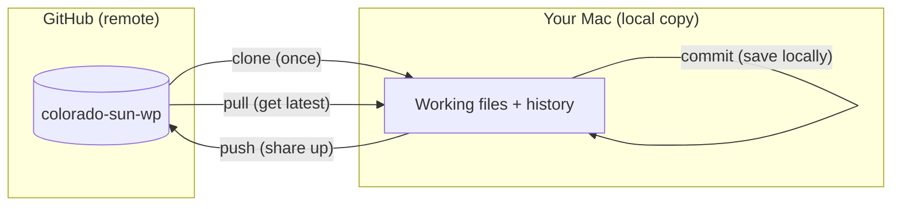
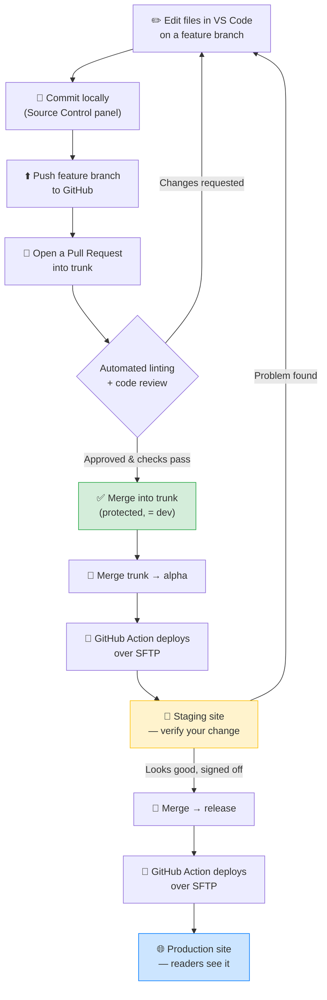

# Getting Started — Colorado Sun WordPress Plugin

Welcome, Kevin! This guide gets you set up from zero on macOS. It assumes you have
used GitHub only in rudimentary ways and have **never cloned a repository before**.

**The twist that makes this easy:** instead of memorizing terminal commands, you'll
let **GitHub Copilot Chat in VS Code (Agent mode)** do the installing for you. For
each step you'll **paste a ready-made prompt**, the agent proposes the commands,
and you click **Continue** to let it run and verify them. Every step still shows
the exact commands (in a *Manual fallback*) so you always know what's happening.

> **Important:** The repository **already exists** on GitHub at
> `thecoloradosun/colorado-sun-wp`, created from the Newspack starter template, and
> you've been added as a **collaborator** (accept the email invite first — see
> [Section 0](#0-before-you-start)). Some later setup (automated deploys) is still
> being configured, but everything in this guide works today.

**Project facts used throughout this guide**

| Thing | Value |
| --- | --- |
| GitHub organization | `thecoloradosun` |
| Repository name | `colorado-sun-wp` |
| Your GitHub username | `kevincosun` |
| Where you'll clone it | `~/Projects/colorado-sun-wp` |
| Node version | Latest LTS (the template's `.nvmrc` says `lts/*`) |

---

## Table of contents

0. [Before you start](#0-before-you-start)
1. [GitHub fundamentals](#1-github-fundamentals)
2. [macOS setup — with your AI pair-programmer](#2-macos-setup--with-your-ai-pair-programmer)
3. [VS Code orientation](#3-vs-code-orientation)
4. [The big picture — one diagram](#4-the-big-picture--one-diagram)
5. [Quick reference](#5-quick-reference)

---

## 0. Before you start

1. **Accept the repo invitation.** Check the email for `kevincosun` (or visit
   <https://github.com/thecoloradosun/colorado-sun-wp>) and click **Accept
   invitation**. Until you accept, you can't clone the private repo.
   - ✅ **Success:** the repo page loads and shows the files instead of a 404.

2. **Have your GitHub password / 2FA handy.** You'll sign in once during setup.

That's the only clicking-around you do up front. Everything else is guided prompts.

---

## 1. GitHub fundamentals

Read this section once; you don't need to type anything yet. These are the five
words you'll hear every day.

### 1.1 The core vocabulary

- **Repository ("repo")** — A project folder that Git tracks. It holds every file
  *plus the complete history* of every change ever made. Ours lives on GitHub at
  `github.com/thecoloradosun/colorado-sun-wp` and also as a copy on each of your Macs.

- **Commit** — A saved snapshot of your changes with a short message describing
  them (e.g. *"Add author byline to article footer"*). Think of it as a labeled
  checkpoint you can always return to. Many small, well-described commits are
  better than one giant one.

- **Branch** — A parallel line of work. You make a **feature branch** off the main
  line, do your commits there, and it stays isolated until it's ready. This lets
  two people work at once without stepping on each other. Our repo has three
  long-lived branches (`trunk`, `alpha`, `release`) explained in
  [1.3](#13-our-branch-model-trunk--alpha--release).

- **Pull request ("PR")** — A formal request to merge your branch into another
  branch. It's where code review, automated **linting** checks, and approval
  happen. Nothing reaches our main branch without a PR. Reviewers (a teammate and
  GitHub Copilot) comment, you adjust, and once approved it merges.

### 1.2 Clone vs. pull vs. push

These three move code between GitHub (the "remote") and your Mac (the "local
copy"). Getting them straight prevents 90% of beginner confusion.

| Command | Direction | When you use it | Plain meaning |
| --- | --- | --- | --- |
| **clone** | GitHub → your Mac | **Once**, at the very start | "Give me a full copy of this repo, including all history." |
| **pull** | GitHub → your Mac | Often, before you start work | "Update my copy with everyone else's latest changes." |
| **push** | your Mac → GitHub | After committing | "Send my new commits up to GitHub so others can see them." |

Mental model:

- You **clone** a repo **exactly once** per machine.
- You **pull** frequently so your copy stays current.
- You **commit** locally to save checkpoints, then **push** to share them.



### 1.3 Our branch model: `trunk → alpha → release`

We use **three long-lived branches**, each mapped to an environment. This is the
heart of our workflow, so make sure it clicks.

| Branch | Role | Environment | What happens when code lands here |
| --- | --- | --- | --- |
| **`trunk`** | Integration / "dev" | *(no site)* | Default, **protected** branch. All pull requests merge here. This is the trusted source of truth. |
| **`alpha`** | Testing | **Staging** | Pushing here **auto-deploys to the staging site** so you can verify your work on a real WordPress install. |
| **`release`** | Production | **Live** | Pushing here **auto-deploys to the production site** that readers see. Only after staging sign-off. |

So the promotion path — **`trunk → alpha → release`** — maps directly to
**dev → staging → production**:

1. Your feature branch merges into **`trunk`** via a reviewed PR (**dev**: the code
   is integrated and trusted, but not yet on any site).
2. You merge `trunk` into **`alpha`** to deploy to **staging** and test on a real
   site.
3. After sign-off, you merge into **`release`** to deploy to **production**.

> **Why staging-only?** We do **not** run WordPress on our laptops. The entire dev
> loop is: *edit → push `alpha` → a GitHub Action deploys to staging over SFTP →
> verify on staging.* You never hand-copy files to the server; automation does it.

---

## 2. macOS setup — with your AI pair-programmer

The plan: install **VS Code** first (it's your editor *and* home of the AI agent),
turn on **Copilot Chat in Agent mode**, then let the agent install and verify the
rest of the toolchain by pasting the prompts below.

**How the agent works (read once):**

- You type a request in the Chat panel. In **Agent mode**, Copilot can propose and
  run **terminal commands** — but it always asks first. You'll see the command and
  an **Allow / Continue** button. Read it, then click to run.
- **Two things only *you* can do** (the agent can't, on purpose):
  1. **Type your Mac login password** when macOS asks in the terminal (installing
     Homebrew needs it). Typing shows no characters — that's normal.
  2. **Sign in to GitHub in your browser** when prompted (the "Authorize" click).
- After each install, ask the agent to **verify the version** — the ✅ lines below
  tell you what a good result looks like.

> **Tip:** paste the prompts **one at a time** and let each finish. Don't paste the
> next one until the current step shows its ✅ success.

### 2.1 Install VS Code (the one fully-manual step)

You need the editor before you can use the agent, so this first step is by hand.

1. Open <https://code.visualstudio.com> in your browser and click **Download for
   macOS**.
2. Open the downloaded `.zip` (it becomes **Visual Studio Code.app**), then drag
   that app into your **Applications** folder.
3. Open **Applications → Visual Studio Code**. If macOS warns it was downloaded
   from the internet, click **Open**.

- ✅ **Success:** VS Code opens to a Welcome tab.

### 2.2 Turn on Copilot Chat (Agent mode)

1. In VS Code, look at the **title bar** for the **Copilot** icon (or press
   `Ctrl + Cmd + I`) to open the **Chat** panel.
2. If prompted, **Sign in** with your GitHub account (`kevincosun`) and enable
   Copilot. (Colorado Sun's org provides your Copilot access — ping Eric if it
   asks you to start a trial.)
3. At the top or bottom of the Chat panel there's a **mode dropdown**. Choose
   **Agent**.
4. Open a working folder so the agent has somewhere to run commands: **File → Open
   Folder…**, create/select a folder named **`Projects`** in your home directory,
   and open it.

- ✅ **Success:** the Chat panel is open, the mode says **Agent**, and there's a
  text box where you can type a prompt.

> From here on, "**Ask the agent:**" means *paste this text into that Chat box and
> press Return*, then approve the commands it proposes.

### 2.3 Install Homebrew (the macOS package manager)

Homebrew (`brew`) installs the other developer tools.

**Ask the agent:**

```text
Check whether Homebrew is installed on this Mac by running `brew --version`.
If it's missing, install Homebrew using the official install script from
brew.sh, then (on Apple Silicon) add it to my PATH in ~/.zprofile and load it.
Finally run `brew --version` again to confirm. Tell me if you need me to type
my Mac password in the terminal.
```

- **You may need to:** type your **Mac login password** in the terminal when the
  installer asks, and press Return to confirm the Command Line Tools install.
- ✅ **Success:** `brew --version` prints `Homebrew 4.x.x`.

<details><summary>Manual fallback</summary>

```bash
/bin/bash -c "$(curl -fsSL https://raw.githubusercontent.com/Homebrew/install/HEAD/install.sh)"
# Apple Silicon only — add brew to PATH:
echo 'eval "$(/opt/homebrew/bin/brew shellenv)"' >> ~/.zprofile
eval "$(/opt/homebrew/bin/brew shellenv)"
brew --version
```
</details>

### 2.4 Install and configure Git

**Ask the agent:**

```text
Install git with Homebrew, then set my global git identity to name "Kevin Co"
and email "<the email on my GitHub account>". Also set the default branch name
to "trunk" and set pull.rebase to false. Then show me `git --version` and
`git config --global --list` so I can confirm.
```

Replace the name/email with your real values (use the email tied to your GitHub
account — it gets stamped on every commit).

- ✅ **Success:** `git --version` is `2.40` or higher, and the config list shows
  your `user.name` and `user.email`.

<details><summary>Manual fallback</summary>

```bash
brew install git
git config --global user.name "Kevin Co"
git config --global user.email "you@example.com"
git config --global init.defaultBranch trunk
git config --global pull.rebase false
git config --global --list
```
</details>

### 2.5 Install the GitHub CLI (`gh`) and sign in

`gh` is GitHub's official command-line tool. Signing in once makes cloning and
pushing "just work" — no passwords or SSH keys to manage.

**Ask the agent:**

```text
Install the GitHub CLI (gh) with Homebrew and show me `gh --version`. Then start
`gh auth login` for me. I'll answer the prompts and finish signing in through my
browser — pause and let me interact with the terminal when it needs me.
```

- **You interact for the sign-in.** When `gh auth login` runs, answer:

  | Prompt | Choose |
  | --- | --- |
  | *What account do you want to log into?* | **GitHub.com** |
  | *Preferred protocol for Git operations?* | **HTTPS** |
  | *Authenticate Git with your GitHub credentials?* | **Yes** |
  | *How would you like to authenticate?* | **Login with a web browser** |

  Copy the **one-time code** it shows, press Return to open the browser, paste the
  code, and click **Authorize**.
- ✅ **Success:** `gh auth status` reports
  `✓ Logged in to github.com account kevincosun`.

<details><summary>Manual fallback</summary>

```bash
brew install gh
gh --version
gh auth login      # choose GitHub.com → HTTPS → Yes → Login with a web browser
gh auth status
```
</details>

### 2.6 Install Node via `nvm` (matching the template's `.nvmrc`)

The plugin's build tools run on **Node.js**. The template pins its version in a
file called `.nvmrc` containing `lts/*` — "the latest Long-Term Support release."
We use **`nvm`** (Node Version Manager) so you can match that automatically.

**Ask the agent:**

```text
Install nvm with Homebrew, then add the nvm setup lines to my ~/.zshrc so it
loads in new terminals (use the Apple Silicon path /opt/homebrew/opt/nvm if this
is an Apple Silicon Mac, otherwise /usr/local/opt/nvm). Reload the shell config,
then install the latest LTS Node with `nvm install --lts`, make it the default,
and show me `node --version` and `npm --version` to confirm.
```

- ✅ **Success:** `node --version` prints `v22.x.x` (or whatever the current LTS is
  — an even major number like 20 or 22) and `npm --version` prints `10.x` or
  higher.

> **Later, inside the cloned repo,** running `nvm use` with no arguments reads the
> repo's `.nvmrc` and switches you to exactly the version the project wants. You'll
> do this once per terminal session while working on the plugin.

<details><summary>Manual fallback</summary>

```bash
brew install nvm
mkdir -p ~/.nvm
cat << 'EOF' >> ~/.zshrc

export NVM_DIR="$HOME/.nvm"
[ -s "/opt/homebrew/opt/nvm/nvm.sh" ] && \. "/opt/homebrew/opt/nvm/nvm.sh"
[ -s "/opt/homebrew/opt/nvm/etc/bash_completion.d/nvm" ] && \. "/opt/homebrew/opt/nvm/etc/bash_completion.d/nvm"
EOF
source ~/.zshrc
nvm install --lts
nvm use --lts
nvm alias default 'lts/*'
node --version && npm --version
```
On an Intel Mac, replace `/opt/homebrew/opt/nvm` with `/usr/local/opt/nvm`.
</details>

### 2.7 Install PHP and Composer

WordPress plugins are PHP. **Composer** manages PHP libraries and the linting tools
our pull requests require. Recent macOS no longer ships PHP, so we install both.

**Ask the agent:**

```text
Install php and composer with Homebrew, then show me `php --version` and
`composer --version` to confirm they're on my PATH.
```

- ✅ **Success:** `php --version` prints `PHP 8.x.x` and `composer --version` prints
  `Composer version 2.x.x`.

<details><summary>Manual fallback</summary>

```bash
brew install php composer
php --version
composer --version
```
</details>

### 2.8 Verify the whole toolchain at once

**Ask the agent:**

```text
Run a single check that prints the versions of git, gh, node, npm, php, composer,
and code (the VS Code CLI). Point out any that report "command not found".
```

- ✅ **Success:** every tool prints a version and **none** says `command not found`.
  If one does, re-run that tool's step above.

<details><summary>Manual fallback</summary>

```bash
echo "git:      $(git --version)"
echo "gh:       $(gh --version | head -n1)"
echo "node:     $(node --version)"
echo "npm:      $(npm --version)"
echo "php:      $(php --version | head -n1)"
echo "composer: $(composer --version)"
echo "code:     $(code --version | head -n1)"
```
If `code` is missing, in VS Code press `Cmd + Shift + P`, run **"Shell Command:
Install 'code' command in PATH"**, then reopen the terminal.
</details>

### 2.9 Clone the repository and open it

Now turn the GitHub repo into a working copy on your Mac.

**Ask the agent:**

```text
Create ~/Projects if it doesn't exist, then clone thecoloradosun/colorado-sun-wp
into it with the gh CLI. Move into the cloned folder, run `nvm use` to match the
project's Node version, then run `npm run setup` to install PHP and Node
dependencies. Tell me if anything fails.
```

- ✅ **Success:** cloning finishes without errors, `nvm use` prints
  `Now using node v22.x.x`, and `npm run setup` ends without red `ERR!` lines.
- **Then open the project:** **File → Open Folder…**, pick
  `~/Projects/colorado-sun-wp`, and open it (or ask the agent to run `code .`).

<details><summary>Manual fallback</summary>

```bash
mkdir -p ~/Projects && cd ~/Projects
gh repo clone thecoloradosun/colorado-sun-wp
cd colorado-sun-wp
nvm use
npm run setup
code .
```
</details>

> Once the project is open, read [`docs/GETTING_STARTED.md`](GETTING_STARTED.md)
> again from inside the repo — you're looking at it now, and it travels with the
> code.

---

## 3. VS Code orientation

You already met the **Chat / Agent** panel in [Section 2](#2-macos-setup--with-your-ai-pair-programmer).
Three more things you'll touch daily — **extensions**, the **Source Control**
panel, and the **integrated terminal** — all framed around our **staging-only**
workflow.

### 3.1 Recommended extensions

Extensions add language support and enforce our shared code style so both machines
behave identically.

**Ask the agent:**

```text
Recommend and install the VS Code extensions this project needs for WordPress PHP
plugin development: PHP Intelephense, a PHP CodeSniffer runner, ESLint, Prettier,
and GitLens. If the repo has a .vscode/extensions.json, install everything it
recommends.
```

Or do it by hand: open **Extensions** (`Cmd + Shift + X`) and install:

| Extension | Publisher | Why we use it |
| --- | --- | --- |
| **PHP Intelephense** | Ben Mewburn | Smart PHP autocomplete and error hints |
| **PHP Sniffer & Beautifier** *(or PHPCS)* | — | Runs the WordPress coding-standard checks locally |
| **ESLint** | Microsoft | Flags JavaScript problems as you type |
| **Prettier** | Prettier | Auto-formats code on save |
| **GitLens** | GitKraken | Shows who changed each line and when |

> When the repo gains a `.vscode/extensions.json` (Roadmap Phase 5), VS Code shows
> a **"This workspace has recommended extensions"** popup — click **Install All**.

- ✅ **Success:** each extension shows a gear icon (installed) instead of **Install**.

### 3.2 The Source Control panel (commit & push without memorizing commands)

The **Source Control** panel is the visual way to stage, commit, and push — great
while you're still learning the Git vocabulary from [Section 1](#1-github-fundamentals).

1. Click the **Source Control** icon in the Activity Bar (three connected dots) or
   press `Cmd + Shift + G`.
2. After you edit files, they appear under **Changes**. Hover a file and click the
   **`+`** to **stage** it (mark it for the next commit).
3. Type a short message in the box at the top (e.g. *"Add byline to footer"*), then
   click the **✓ Commit** button. This creates a commit **on your current branch,
   locally**.
4. Click **Sync Changes** (or the **`…` menu → Push**) to **push** your commits up
   to GitHub.

- ✅ **Success:** after pushing, the "outgoing" counter next to the branch name at
  the bottom-left returns to `0`, meaning GitHub now has your commits.

> You can also just **ask the agent**: *"Stage my changes, commit them with a clear
> message describing what I changed, and push the current branch."* It'll show you
> the commit message before running.

> **Staging-workflow reminder:** committing and pushing a **feature branch** does
> **not** deploy anything. Deployment only happens when code reaches **`alpha`**
> (→ staging) or **`release`** (→ production). See the diagram in
> [Section 4](#4-the-big-picture--one-diagram).

### 3.3 The integrated terminal

VS Code has a built-in terminal so you never leave the editor — and it's the same
terminal the agent uses.

1. Open it with **View → Terminal**, or press `` Ctrl + ` `` (Control plus the
   backtick key, top-left of the keyboard).
2. It opens **already inside your project folder**, so commands run against the
   right code.
3. The commands you'll run most often (or ask the agent to run) while building:

   | Command | What it does | When |
   | --- | --- | --- |
   | `nvm use` | Switch to the project's Node version | Once per new terminal |
   | `composer phpcs` | Run the PHP coding-standard checks | Before every push |
   | `npm run lint` | Run the JavaScript/CSS checks | Before every push |
   | `npm run build` | Compile the plugin's assets | Before testing on staging |

- ✅ **Success:** `composer phpcs` and `npm run lint` finish with **no errors** —
  the same checks that must pass on your pull request, so running them here first
  saves round-trips. If they fail, ask the agent: *"Explain these lint errors and
  fix them,"* then re-run.

> **Why this matters for staging-only:** because we can't test on a local WordPress
> site, these local checks + the staging deploy are your safety net. Green linters
> locally → open a PR → merge to `trunk` → merge to `alpha` → verify on staging.

---

## 4. The big picture — one diagram

This is the full journey of a change, from your keyboard to the live site. Keep it
handy — everything in this guide feeds into it.



**Read it as a sentence:** You *edit* on a feature branch, *commit* and *push*,
open a *pull request* into **`trunk`**; once linting passes and a reviewer approves,
it *merges* into `trunk` (**dev**). You promote `trunk` → **`alpha`** to
auto-deploy to **staging**, verify on the real site, and after sign-off promote to
**`release`** to auto-deploy to **production**.

---

## 5. Quick reference

**Daily loop, in commands** (or paste any line into the agent and let it run):

```bash
cd ~/Projects/colorado-sun-wp   # go to the project
nvm use                         # match the project's Node version
git pull                        # get everyone's latest changes
git switch -c my-feature        # start a new feature branch
# ...edit files in VS Code...
composer phpcs                  # check PHP standards
npm run lint                    # check JS/CSS standards
git add -A                      # stage all changes
git commit -m "Describe change" # save a checkpoint locally
git push -u origin my-feature   # send the branch to GitHub
gh pr create --base trunk       # open a pull request into trunk
```

**Handy agent prompts:**

- *"Start a new feature branch off trunk called `add-footer-note`."*
- *"Run the PHP and JS linters and fix anything they flag."*
- *"Commit my changes with a clear message and push this branch."*
- *"Open a pull request from this branch into trunk and summarize what changed."*

**The three environment branches at a glance:**

| Branch | Push here to deploy to | Meaning |
| --- | --- | --- |
| `trunk` | *(nothing — protected)* | Dev / integration; all PRs merge here |
| `alpha` | **Staging** | Test on a real site |
| `release` | **Production** | Live for readers |

**If a tool "isn't found" in the terminal:** re-run that tool's step in
[Section 2](#2-macos-setup--with-your-ai-pair-programmer) (or ask the agent to
reinstall it), then reopen the terminal.

---

*Next up (Roadmap Phase 4+): automated staging/production deploys are being
configured. The repo already exists, so clone it now via
[Section 2.9](#29-clone-the-repository-and-open-it) and start exploring the code.*
