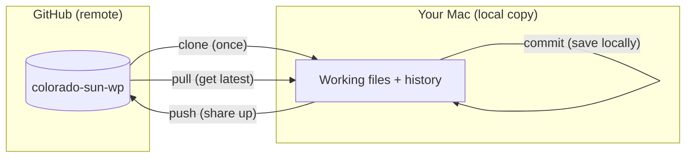
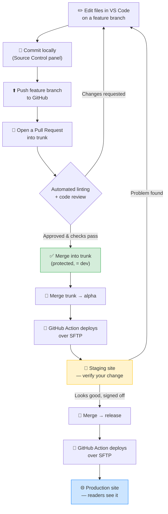

# Getting Started — Colorado Sun WordPress Plugin

Welcome! This guide gets **both developers** set up from zero on macOS. It assumes
you have used GitHub only in rudimentary ways and that you have **never cloned a
repository before**. Every action is numbered, shows the exact command, and tells
you **what success looks like**.

> **Important:** The repository **already exists** on GitHub at
> `thecoloradosun/colorado-sun-wp`, created from the Newspack starter template.
> Install and verify the tools in [Section 2](#2-macos-environment-setup), then
> clone it in [Section 2.8](#28-clone-the-repository). Some later setup (automated
> deploys) is still being configured, but everything in this guide works today.

**Project facts used throughout this guide**

| Thing | Value |
| --- | --- |
| GitHub organization | `thecoloradosun` |
| Repository name | `colorado-sun-wp` |
| Where you'll clone it | `~/Projects/colorado-sun-wp` |
| Node version | Latest LTS (the template's `.nvmrc` says `lts/*`) |

---

## Table of contents

1. [GitHub fundamentals](#1-github-fundamentals)
2. [macOS environment setup](#2-macos-environment-setup)
3. [VS Code orientation](#3-vs-code-orientation)
4. [The big picture — one diagram](#4-the-big-picture--one-diagram)
5. [Quick reference](#5-quick-reference)

---

## 1. GitHub fundamentals

Before touching a terminal, learn the five words you'll hear every day. Read this
section once; you don't need to type anything yet.

### 1.1 The core vocabulary

- **Repository ("repo")** — A project folder that Git tracks. It holds every file
  *plus the complete history* of every change ever made. Ours lives on GitHub at
  `github.com/thecoloradosun/colorado-sun-wp` and also as a copy on each of your Macs.

- **Commit** — A saved snapshot of your changes with a short message describing
  them (e.g. *"Add author byline to article footer"*). Think of it as a labeled
  checkpoint you can always return to. Many small, well-described commits are
  better than one giant one.

- **Branch** — A parallel line of work. You make a **feature branch** off the main
  line, do your commits there, and it stays isolated until it's ready. This lets
  two people work at once without stepping on each other. Our repo has three
  long-lived branches (`trunk`, `alpha`, `release`) explained in
  [1.3](#13-our-branch-model-trunk--alpha--release).

- **Pull request ("PR")** — A formal request to merge your branch into another
  branch. It's where code review, automated **linting** checks, and approval
  happen. Nothing reaches our main branch without a PR. Reviewers (a teammate and
  GitHub Copilot) comment, you adjust, and once approved it merges.

### 1.2 Clone vs. pull vs. push

These three move code between GitHub (the "remote") and your Mac (the "local
copy"). Getting them straight prevents 90% of beginner confusion.

| Command | Direction | When you use it | Plain meaning |
| --- | --- | --- | --- |
| **clone** | GitHub → your Mac | **Once**, at the very start | "Give me a full copy of this repo, including all history." |
| **pull** | GitHub → your Mac | Often, before you start work | "Update my copy with everyone else's latest changes." |
| **push** | your Mac → GitHub | After committing | "Send my new commits up to GitHub so others can see them." |

Mental model:

- You **clone** a repo **exactly once** per machine.
- You **pull** frequently so your copy stays current.
- You **commit** locally to save checkpoints, then **push** to share them.



### 1.3 Our branch model: `trunk → alpha → release`

We use **three long-lived branches**, each mapped to an environment. This is the
heart of our workflow, so make sure it clicks.

| Branch | Role | Environment | What happens when code lands here |
| --- | --- | --- | --- |
| **`trunk`** | Integration / "dev" | *(no site)* | Default, **protected** branch. All pull requests merge here. This is the trusted source of truth. |
| **`alpha`** | Testing | **Staging** | Pushing here **auto-deploys to the staging site** so you can verify your work on a real WordPress install. |
| **`release`** | Production | **Live** | Pushing here **auto-deploys to the production site** that readers see. Only after staging sign-off. |

So the promotion path — **`trunk → alpha → release`** — maps directly to
**dev → staging → production**:

1. Your feature branch merges into **`trunk`** via a reviewed PR (**dev**: the code
   is integrated and trusted, but not yet on any site).
2. You merge `trunk` into **`alpha`** to deploy to **staging** and test on a real
   site.
3. After sign-off, you merge into **`release`** to deploy to **production**.

> **Why staging-only?** We do **not** run WordPress on our laptops. The entire dev
> loop is: *edit → push `alpha` → a GitHub Action deploys to staging over SFTP →
> verify on staging.* You never hand-copy files to the server; automation does it.

---

## 2. macOS environment setup

Now the hands-on part. You'll install and verify **five tools**: Homebrew (a helper
to install the rest), Git, Node (via `nvm`), Composer, and VS Code — plus the
GitHub CLI (`gh`) for authentication.

> **How to open the Terminal:** Press `Cmd + Space`, type `Terminal`, press
> `Return`. A window with a text prompt opens. You type a command and press
> `Return` to run it. That's it.

> **Reading the tables below:** each step shows the **command** to run and the
> **✅ success check** — what you should see if it worked.

### 2.1 Install Homebrew (the macOS package manager)

Homebrew (`brew`) is the standard way to install developer tools on macOS. We use
it for Git, Composer, the GitHub CLI, and `nvm`.

1. **Check whether you already have it:**

   ```bash
   brew --version
   ```

   - ✅ **Success:** you see something like `Homebrew 4.x.x`. **Skip to
     [2.2](#22-install-and-verify-git).**
   - If you instead see `command not found: brew`, continue to step 2.

2. **Install Homebrew:**

   ```bash
   /bin/bash -c "$(curl -fsSL https://raw.githubusercontent.com/Homebrew/install/HEAD/install.sh)"
   ```

   Follow the prompts (it may ask for your Mac login password — typing shows no
   characters, that's normal — and to install Apple's Command Line Tools).

3. **On Apple Silicon Macs (M1/M2/M3), add Homebrew to your PATH** so the terminal
   can find it. (On older Intel Macs you can skip this.)

   ```bash
   echo 'eval "$(/opt/homebrew/bin/brew shellenv)"' >> ~/.zprofile
   eval "$(/opt/homebrew/bin/brew shellenv)"
   ```

4. **Verify:**

   ```bash
   brew --version
   ```

   - ✅ **Success:** `Homebrew 4.x.x` (any 4.x is fine).

### 2.2 Install and verify Git

Git is the version-control engine underneath everything. macOS may ship an old
copy; installing via Homebrew gives you a current one.

1. **Install:**

   ```bash
   brew install git
   ```

2. **Verify:**

   ```bash
   git --version
   ```

   - ✅ **Success:** `git version 2.40.0` or higher.

3. **Tell Git who you are** (this name/email is stamped on every commit — use the
   email tied to your GitHub account):

   ```bash
   git config --global user.name "Your Name"
   git config --global user.email "you@example.com"
   ```

4. **Set the default branch name** and a sensible pull behavior:

   ```bash
   git config --global init.defaultBranch trunk
   git config --global pull.rebase false
   ```

5. **Confirm your settings:**

   ```bash
   git config --global --list
   ```

   - ✅ **Success:** you see your `user.name` and `user.email` in the output.

### 2.3 Install and authenticate the GitHub CLI (`gh`)

`gh` is GitHub's official command-line tool. We use it to **log in once** (so
cloning and pushing "just work" without fiddling with passwords or SSH keys) and
later to work with pull requests from the terminal.

1. **Install:**

   ```bash
   brew install gh
   ```

2. **Verify:**

   ```bash
   gh --version
   ```

   - ✅ **Success:** `gh version 2.x.x`.

3. **Log in to GitHub** (this is the important one):

   ```bash
   gh auth login
   ```

   Answer the interactive prompts like this:

   | Prompt | Choose |
   | --- | --- |
   | *What account do you want to log into?* | **GitHub.com** |
   | *What is your preferred protocol for Git operations?* | **HTTPS** |
   | *Authenticate Git with your GitHub credentials?* | **Yes** |
   | *How would you like to authenticate?* | **Login with a web browser** |

   `gh` shows a **one-time code** and opens your browser. Type/paste the code,
   click **Authorize**, and return to the terminal.

4. **Confirm you're logged in:**

   ```bash
   gh auth status
   ```

   - ✅ **Success:** `✓ Logged in to github.com account <your-username>`. This also
     configured Git to authenticate as you, so future `clone`/`push` need no
     password.

### 2.4 Install Node via `nvm` (matching the template's `.nvmrc`)

The plugin's build tools run on **Node.js**. The template pins its Node version in
a file named `.nvmrc`, which contains `lts/*` — meaning **"the latest Long-Term
Support release."** We install **`nvm`** (Node Version Manager) so you can match
that automatically and switch versions per project.

1. **Install `nvm`:**

   ```bash
   brew install nvm
   ```

2. **Enable `nvm` in your shell** (this makes the `nvm` command available every
   time you open a terminal):

   ```bash
   mkdir -p ~/.nvm
   cat << 'EOF' >> ~/.zshrc

   export NVM_DIR="$HOME/.nvm"
   [ -s "/opt/homebrew/opt/nvm/nvm.sh" ] && \. "/opt/homebrew/opt/nvm/nvm.sh"
   [ -s "/opt/homebrew/opt/nvm/etc/bash_completion.d/nvm" ] && \. "/opt/homebrew/opt/nvm/etc/bash_completion.d/nvm"
   EOF
   ```

   > On an Intel Mac, replace `/opt/homebrew/opt/nvm` with `/usr/local/opt/nvm` in
   > both lines above.

3. **Load the new settings** (or just quit and reopen Terminal):

   ```bash
   source ~/.zshrc
   ```

4. **Verify `nvm` works:**

   ```bash
   nvm --version
   ```

   - ✅ **Success:** `0.39.x` or similar.

5. **Install the latest LTS Node** (this is what `lts/*` resolves to):

   ```bash
   nvm install --lts
   nvm use --lts
   nvm alias default 'lts/*'
   ```

6. **Verify Node and npm:**

   ```bash
   node --version
   npm --version
   ```

   - ✅ **Success:** `node --version` prints `v22.x.x` (or whatever the current LTS
     is — an even major number like 20 or 22), and `npm --version` prints `10.x.x`
     or higher.

   > **Later, inside the cloned repo:** running `nvm use` with no arguments reads
   > the repo's `.nvmrc` and switches you to exactly the version the project wants.
   > You'll do this once per terminal session when working on the plugin.

### 2.5 Install and verify Composer (PHP dependencies)

WordPress plugins are PHP. **Composer** manages PHP libraries and the linting
tools our pull requests require. It needs PHP, which recent macOS no longer ships,
so we install both.

1. **Install PHP and Composer:**

   ```bash
   brew install php composer
   ```

2. **Verify PHP:**

   ```bash
   php --version
   ```

   - ✅ **Success:** `PHP 8.x.x`.

3. **Verify Composer:**

   ```bash
   composer --version
   ```

   - ✅ **Success:** `Composer version 2.x.x`.

### 2.6 Install VS Code

VS Code is the editor we'll both use. Installing the `code` command lets you open
projects from the terminal.

1. **Install VS Code:**

   ```bash
   brew install --cask visual-studio-code
   ```

2. **Verify:**

   ```bash
   code --version
   ```

   - ✅ **Success:** a version number like `1.9x.x` on the first line.

   > If `code` isn't found, open VS Code manually, press
   > `Cmd + Shift + P`, type **"Shell Command: Install 'code' command in PATH"**,
   > and press `Return`. Then reopen the terminal and try again.

### 2.7 Final verification — everything at once

Run this block to confirm all tools are present. This is your "am I ready?" check.

```bash
echo "git:      $(git --version)"
echo "gh:       $(gh --version | head -n1)"
echo "node:     $(node --version)"
echo "npm:      $(npm --version)"
echo "php:      $(php --version | head -n1)"
echo "composer: $(composer --version)"
echo "code:     $(code --version | head -n1)"
```

- ✅ **Success:** every line prints a version number and **none** says
  `command not found`. If one does, revisit that tool's section above.

### 2.8 Clone the repository

This is the moment you turn the GitHub repo into a working copy on your Mac.

1. **Create a projects folder and move into it:**

   ```bash
   mkdir -p ~/Projects
   cd ~/Projects
   ```

2. **Clone the repo** (thanks to `gh auth login`, no password is needed):

   ```bash
   gh repo clone thecoloradosun/colorado-sun-wp
   ```

   - ✅ **Success:** you see `Cloning into 'colorado-sun-wp'...` followed by
     progress lines, ending back at the prompt with no errors. A new folder
     `~/Projects/colorado-sun-wp` now exists.

3. **Move into the project and match its Node version:**

   ```bash
   cd colorado-sun-wp
   nvm use
   ```

   - ✅ **Success:** `nvm use` prints `Now using node v22.x.x (npm ...)`, read from
     the repo's `.nvmrc`.

4. **Install the project's dependencies** (this reads the repo's setup script and
   pulls both PHP and Node packages):

   ```bash
   npm run setup
   ```

   - ✅ **Success:** it finishes without red `ERR!` lines. You're ready to work.

5. **Open the project in VS Code:**

   ```bash
   code .
   ```

   - ✅ **Success:** VS Code opens with the `colorado-sun-wp` files listed in the
     left sidebar.

---

## 3. VS Code orientation

VS Code will be your daily workspace. This section covers the three things you'll
touch constantly — **extensions**, the **Source Control panel**, and the
**integrated terminal** — framed around our **staging-only** workflow.

### 3.1 Install the recommended extensions

Extensions add language support and enforce our shared code style so both your
machines behave identically.

1. Open VS Code, then open the **Extensions** view: click the square icon in the
   left **Activity Bar**, or press `Cmd + Shift + X`.
2. Search for and **Install** each of these:

   | Extension | Publisher | Why we use it |
   | --- | --- | --- |
   | **PHP Intelephense** | Ben Mewburn | Smart PHP autocomplete and error hints |
   | **PHP Sniffer & Beautifier** *(or PHPCS)* | — | Runs the WordPress coding-standard checks locally |
   | **ESLint** | Microsoft | Flags JavaScript problems as you type |
   | **Prettier** | Prettier | Auto-formats code on save |
   | **GitLens** | GitKraken | Shows who changed each line and when |

   > Once the repo is cloned, it will include a `.vscode/extensions.json` file.
   > VS Code then shows a **"This workspace has recommended extensions"** popup —
   > click **Install All** and you're done in one click. (That file arrives in
   > Roadmap Phase 5.)

3. ✅ **Success:** each extension shows a gear icon (installed) instead of an
   **Install** button.

### 3.2 The Source Control panel (commit & push without memorizing commands)

The **Source Control** panel is the visual way to stage, commit, and push — great
while you're still learning the Git vocabulary from [Section 1](#1-github-fundamentals).

1. Click the **Source Control** icon in the Activity Bar (three connected dots) or
   press `Cmd + Shift + G`.
2. After you edit files, they appear under **Changes**. Hover a file and click the
   **`+`** to **stage** it (mark it for the next commit).
3. Type a short message in the box at the top (e.g. *"Add byline to footer"*), then
   click the **✓ Commit** button. This creates a commit **on your current branch,
   locally**.
4. Click **Sync Changes** (or the **`…` menu → Push**) to **push** your commits up
   to GitHub.

- ✅ **Success:** after pushing, the little "outgoing" counter next to the branch
  name at the bottom-left returns to `0`, meaning GitHub now has your commits.

> **Staging-workflow reminder:** committing and pushing a **feature branch** does
> **not** deploy anything. Deployment only happens when code reaches **`alpha`**
> (→ staging) or **`release`** (→ production). See the diagram in
> [Section 4](#4-the-big-picture--one-diagram).

### 3.3 The integrated terminal

VS Code has a built-in terminal so you never leave the editor. This is where you'll
run `nvm use`, the linters, and the build.

1. Open it with **View → Terminal**, or press `` Ctrl + ` `` (Control plus the
   backtick key, top-left of the keyboard).
2. It opens **already inside your project folder**, so commands run against the
   right code.
3. The commands you'll run most often while building the plugin:

   | Command | What it does | When |
   | --- | --- | --- |
   | `nvm use` | Switch to the project's Node version | Once per new terminal |
   | `composer phpcs` | Run the PHP coding-standard checks | Before every push |
   | `npm run lint` | Run the JavaScript/CSS checks | Before every push |
   | `npm run build` | Compile the plugin's assets | Before testing on staging |

- ✅ **Success:** `composer phpcs` and `npm run lint` finish with **no errors**.
  These are the same checks that must pass on your pull request, so running them
  here first saves round-trips. If they fail, fix the reported files and re-run
  before pushing.

> **Why this matters for staging-only:** because we can't test on a local
> WordPress site, these local checks + the staging deploy are your safety net.
> Green linters locally → open a PR → merge to `trunk` → merge to `alpha` → verify
> on the real staging site.

---

## 4. The big picture — one diagram

This is the full journey of a change, from your keyboard to the live site. Keep it
handy — everything in this guide feeds into it.



**Read it as a sentence:** You *edit* on a feature branch, *commit* and *push*,
open a *pull request* into **`trunk`**; once linting passes and a reviewer approves,
it *merges* into `trunk` (**dev**). You promote `trunk` → **`alpha`** to
auto-deploy to **staging**, verify on the real site, and after sign-off promote to
**`release`** to auto-deploy to **production**.

---

## 5. Quick reference

**Daily loop, in commands:**

```bash
cd ~/Projects/colorado-sun-wp   # go to the project
nvm use                         # match the project's Node version
git pull                        # get everyone's latest changes
git switch -c my-feature        # start a new feature branch
# ...edit files in VS Code...
composer phpcs                  # check PHP standards
npm run lint                    # check JS/CSS standards
git add -A                      # stage all changes
git commit -m "Describe change" # save a checkpoint locally
git push -u origin my-feature   # send the branch to GitHub
gh pr create --base trunk       # open a pull request into trunk
```

**The three environment branches at a glance:**

| Branch | Push here to deploy to | Meaning |
| --- | --- | --- |
| `trunk` | *(nothing — protected)* | Dev / integration; all PRs merge here |
| `alpha` | **Staging** | Test on a real site |
| `release` | **Production** | Live for readers |

**If something isn't found in the terminal:** re-run the matching install step in
[Section 2](#2-macos-environment-setup), then reopen the terminal.

---

*Next up (Roadmap Phase 4+): automated staging/production deploys are being
configured. The repo already exists, so you can clone it now via
[Section 2.8](#28-clone-the-repository) and start exploring the code.*
